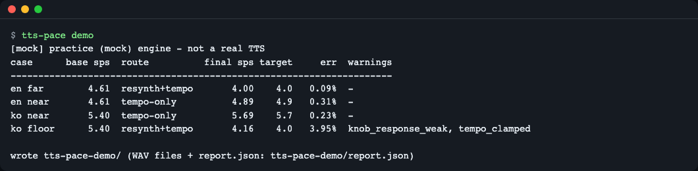
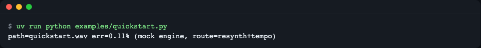
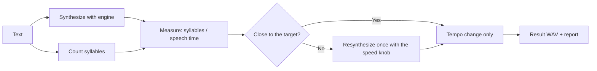
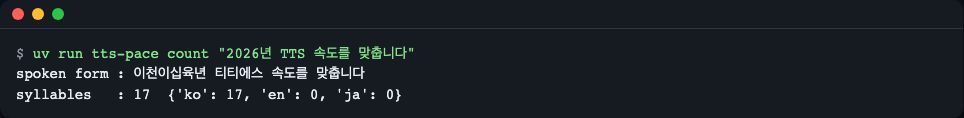
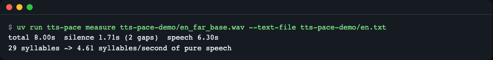
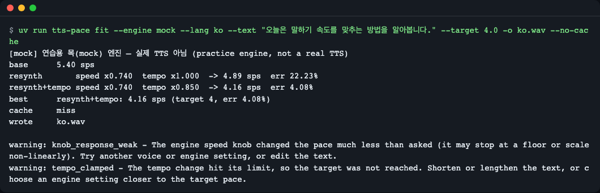

# tts-pace

[한국어](README.md) | **English**

A small Python library and CLI that measures the speaking rate of speech audio (syllables per second of *pure speech*, silences excluded) and fits a TTS engine's output to a target pace: first with the engine's own speed knob, then with a bounded, pitch-preserving tempo change. You can also give a target total length in seconds (`--target-duration`) instead of a pace. One runtime dependency (numpy), no API key, and a practice (mock) engine so you can try everything offline. Install: `uv add git+https://github.com/LeeGyeongPil/tts-pace`.

A Python library and command-line tool that measures how many syllables per second a TTS voice speaks, and fits it to a target pace. Use it when there is a requirement such as "this sentence must finish within 4 seconds", as in video dubbing, narration or reading aloud.

By analogy, a TTS speed setting is a faucet with no markings: you cannot tell whether turning it further gives proportionally more water. tts-pace fits a meter to the faucet and turns it a little again by hand while reading the dial.



*Result of running `tts-pace demo` (practice mock engine). Three of the four cases are within 0.5% error, and the last line is a case that hit a limit and raised warnings.*

## Installation

```bash
# To use as a library (add to your project)
uv add git+https://github.com/LeeGyeongPil/tts-pace

# To clone the repository and try it right away
git clone https://github.com/LeeGyeongPil/tts-pace && cd tts-pace && uv sync
```

- Requirements: Python 3.12 or later, [uv](https://docs.astral.sh/uv/) (if missing, `curl -LsSf https://astral.sh/uv/install.sh | sh`). On a minimal Linux container you only need `git` and `curl` in addition.
- The runtime dependency is **numpy alone**. ffmpeg, `say` and Piper are optional.
- No API key is needed. All environment variables are optional and are listed in [.env.example](.env.example).

## Quick start

This is `examples/quickstart.py`. It runs as is when copied.

```python
from tts_pace import MockEngine, fit

result = fit(
    "Today we learn how to match the speaking rate of a synthetic voice.",
    target_sps=4.0,
    engine=MockEngine("en"),
    out="quickstart.wav",
)
print(f"path={result.best.path} err={result.best.err_pct:.2f}% (mock engine, route={result.route})")
```

```bash
uv run python examples/quickstart.py
```

```text
path=quickstart.wav err=0.11% (mock engine, route=resynth+tempo)
```



*`MockEngine` is a **practice mock engine**. It is not real speech; it merely produces short sound chunks and pauses, one chunk per syllable, but the measurement and tempo-change code goes through exactly the same path as with a real one. Real TTS is swapped in with `SayEngine`, `PiperEngine` or `CallableEngine` (see [API](#api) below).*

## Core concepts

1. **Speaking rate (sps)**: the number of syllables divided by the *speech time with pauses removed* (syllables per second). Dividing by the character count or by the total length makes the value wobble because of pauses between sentences, so silences lasting 0.6 seconds or more are subtracted from the time.
2. **Speed knob**: the "faster/slower" setting a TTS engine offers. But even if you give 1.2x, there is no guarantee the actual speed becomes 1.2x (it is non-linear and stops at a floor). So it **measures to confirm**.
3. **Pitch-preserving tempo change**: post-processing that changes only the playback speed without changing the voice's pitch. Large changes damage the sound, so it is limited to 0.85-1.15x and used only for the final fine adjustment.
4. **Closed-loop control**: "synthesize → measure → compare → correct" runs as a closed loop, in the same way an air conditioner measures the temperature and adjusts its power.



Walking through the diagram step by step:

- **Counting syllables**: after converting numbers and abbreviations to how they are read aloud (`2026` → `이천이십육`, "two thousand twenty-six"), it counts Hangul blocks, English vowel groups and Japanese morae.
- **Measuring**: dividing by the speech time with pauses removed gives sps.
- **Deciding**: if the error of the base synthesis is within 10%, it leaves the knob alone and only changes the tempo (`tempo-only`). Otherwise it adjusts the knob once and resynthesizes (`resynth`), then closes the remaining error with the tempo (`resynth+tempo`).
- **Result**: it picks the candidate closest to the target, and if a limit was hit it returns a warning and advice text along with it.

## Step-by-step walkthrough

Run these in order from the folder where you cloned the repository (all without keys, with the mock engine, in about 0.2 seconds each).

### 1. Run the demo in one go

```bash
uv run tts-pace demo
```

```text
[mock] 연습용 목(mock) 엔진 — 실제 TTS 아님 (practice engine, not a real TTS)
case      base sps  route          final sps target     err  warnings
---------------------------------------------------------------------
en far        4.61  resynth+tempo       4.00    4.0   0.09%  -
en near       4.61  tempo-only          4.89    4.9   0.31%  -
ko near       5.40  tempo-only          5.69    5.7   0.23%  -
ko floor      5.40  resynth+tempo       4.16    4.0   3.95%  knob_response_weak, tempo_clamped

wrote tts-pace-demo/ (WAV files + report.json: tts-pace-demo/report.json)
```

(The first line's Korean part means "practice mock engine, not a real TTS".)

What it means: `base sps` is the speed of the first synthesis, `route` is the method used to fit, and `err` is the difference from the target. `en far` had a distant target so it used the knob as well, while `en near` and `ko near` were close and used the tempo only. `ko floor` is a case where this fake Korean engine is built so that it cannot get slower than its speed floor, so 3.95% error remains and warnings are attached. The generated WAV files and `report.json` are saved in `tts-pace-demo/`.

### 2. Counting syllables

```bash
uv run tts-pace count "2026년 TTS 속도를 맞춥니다"
```

```text
spoken form : 이천이십육년 티티에스 속도를 맞춥니다
syllables   : 17  {'ko': 17, 'en': 0, 'ja': 0}
```

(The input means "We adjust the TTS speed in 2026".)



*After numbers and abbreviations are converted to how they are read, 17 syllables are counted.*

What it means: TTS reads `2026` as "이천이십육", so counting the characters literally would skew the speed. It counts based on the form converted to how it is read (`spoken form`).

### 3. Measuring the speaking rate of a recording

```bash
uv run tts-pace measure tts-pace-demo/en_far_base.wav --text-file tts-pace-demo/en.txt
```

```text
total 8.00s  silence 1.71s (2 gaps)  speech 6.30s
29 syllables -> 4.61 syllables/second of pure speech
```



*Of the total 8.00 seconds, 1.71 seconds of pauses are removed, and 29 syllables were spoken in 6.30 seconds, so it is 4.61 sps.*

What it means: dividing by the total length (8.00 seconds) would give a slow-looking 3.6 sps or so, but the pauses between sentences are not speaking rate. The value with pauses removed is the basis for comparison.

### 4. Fitting to a target (a case that raises warnings)

```bash
uv run tts-pace fit --engine mock --lang ko \
  --text "오늘은 말하기 속도를 맞추는 방법을 알아봅니다." \
  --target 4.0 -o ko.wav --no-cache
```

```text
warning: knob_response_weak - The engine speed knob changed the pace much less than asked (it may stop at a floor or scale non-linearly). Try another voice or engine setting, or edit the text.
warning: tempo_clamped - The tempo change hit its limit, so the target was not reached. Shorten or lengthen the text, or choose an engine setting closer to the target pace.
[mock] 연습용 목(mock) 엔진 — 실제 TTS 아님 (practice engine, not a real TTS)
base      5.40 sps
resynth       speed x0.740  tempo x1.000  -> 4.89 sps  err 22.23%
resynth+tempo speed x0.740  tempo x0.850  -> 4.16 sps  err 4.08%
best      resynth+tempo: 4.16 sps (target 4, err 4.08%)
cache     miss
wrote     ko.wav
```

(The input text means "Today we learn how to match the speaking pace.")



*When aiming for 4.0 sps from 5.40 sps: even lowering the speed knob to 0.74x only brings it down to 4.89 sps, and even using the tempo up to its limit (0.85x) it stops at 4.16 sps.*

What it means: the knob was set to 0.74x but the speed did not drop by that much (`knob_response_weak`). The tempo change also hit the 0.85x floor (`tempo_clamped`). In such a case the tool does not stretch things by force; it returns the result closest to the target along with warnings. As advised, you need to adjust the sentence length or the target.

Instead of a speed, you can also give the target as "how many seconds in total, pauses included". `--target` and `--target-duration` cannot be used together, and one of them must be given (otherwise exit code 2).

```bash
uv run tts-pace fit --engine mock --text "Today we learn how to match the rate." \
  --target-duration 4 -o o.wav --no-cache
```

```text
warning: tempo_clamped - The tempo change hit its limit, so the target was not reached. Shorten or lengthen the text, or choose an engine setting closer to the target pace.
[mock] 연습용 목(mock) 엔진 — 실제 TTS 아님 (practice engine, not a real TTS)
base      4.60 sps
resynth       speed x0.714  tempo x1.000  -> 3.77 sps  err 14.60%
resynth+tempo speed x0.714  tempo x0.850  -> 3.22 sps  err 2.15%
best      resynth+tempo: 3.22 sps (target 3.2864, err 2.15%)
length    3.85s (target 4.00s, err 3.85%)
cache     miss
wrote     o.wav
```

What it means: it stopped at 3.85 seconds for a 4.00-second target. The tempo hit the 0.85x floor (`tempo_clamped`), and the `length` line tells you the remaining difference. The `length` line appears only when `--target-duration` is used.

The `target 3.2864` on the `best` line is the target sps obtained by converting the 4-second target length into this sentence's speaking rate with pauses excluded (that is why it has a different number of decimal places from the other lines).

For use in scripts, add `--json` (since 0.3.0). Only one line of report JSON goes to standard output, and warnings and the `[mock]` notice go to standard error. It is the same content as what is saved in the `--report` file.

```bash
uv run tts-pace fit --engine mock --text "Today we learn pace." \
  --target 4 -o o.wav --no-cache --json 2>/dev/null
```

```text
{"version": 1, "engine": "mock-en", "mock": true, "mock_note": "practice (mock) engine, not a real TTS", "target_sps": 4.0, ...
```

(Only the beginning of the output is shown. It continues with `syllables`, `route`, `best`, `candidates`, `warnings`, `cache_hit` and so on.)

The cache defaults differ between the CLI and the library. The CLI caches in `~/.cache/tts-pace` by default, and the library's `fit()` does not cache unless you give `cache_dir` (or the environment variable `TTS_PACE_CACHE_DIR`).

If you use `--cache-dir "$HOME/.cache/tts-pace"` instead of `--no-cache` in the same command (the default cache location is `~/.cache/tts-pace`, changeable with `TTS_PACE_CACHE_DIR`), `cache     hit` appears from the second run and synthesis is skipped.

### 5. Fitting an existing recording with the tempo alone

```bash
uv run tts-pace retime tts-pace-demo/en_far_base.wav --text-file tts-pace-demo/en.txt --target 4.2 -o slower.wav
```

To fit by total length, use `--target-duration 9` instead of `--target 4.2`. This file is originally about 8 seconds, so this stretches it in the slower (longer) direction.

```bash
uv run tts-pace retime tts-pace-demo/en_far_base.wav --text-file tts-pace-demo/en.txt --target-duration 9 -o slower.wav
```

```text
base      4.61 sps
tempo-only    speed x1.000  tempo x0.889  -> 4.10 sps  err 0.01%
best      tempo-only: 4.10 sps (target 4.09641, err 0.01%)
length    8.97s (target 9.00s, err 0.30%)
cache     miss
wrote     slower.wav
```

This is the command to use when you have only a file and no engine. If the target is too far (for example `--target 2.0`), it stops at the 0.85x floor and raises a `tempo_clamped` warning. The exit code is still 0 in that case, so in automation check for warnings in the `warnings` field of the `--json` output (both `retime --json` and `fit --json`) or in the report.

## API

These are the public names exported by `tts_pace`. Do not use module-internal functions that are not listed here.

| Name | What it does | Main arguments | Returns |
|---|---|---|---|
| `count_syllables(text, lang="auto", normalize=None)` | Syllable count based on how the text is read | `lang`: `auto/ko/en/ja` (affects only the reading of numbers and abbreviations), `normalize`: `{"2026": "twenty twenty six"}` | `SyllableCount` (`total`, `by_script`, `normalized_text`, `unsupported`) |
| `measure(audio, text=None, syllables=None, *, silence_db=-60.0, min_silence=0.6, backend="auto", limiter=None)` | Measures speech time with pauses removed, and speaking rate | `audio`: a WAV path or an `AudioClip`; `text` and `syllables` cannot be given together | `Measurement` (`total_s`, `silence_s`, `net_s`, `gaps`, `sps`) |
| `retime(audio, factor, out=None, backend="auto", clamp=False, *, tempo_range=(0.85, 1.15), limiter=None)` | Changes speed while keeping pitch (1.1 = 10% faster) | A `factor` outside the range raises `ValueError`; with `clamp=True` it is cut to the boundary | `AudioClip` |
| `fit(text, target_sps, engine, out=None, *, target_duration=None, tolerance=0.10, tempo_range, cache_dir=None, lang="auto", normalize=None, limiter=None, keep_candidates=False, silence_db, min_silence, tempo_backend, measure_backend)` | Closed loop of synthesize → measure → knob/tempo correction | `engine`: `SpeedEngine`; `cache_dir`: a folder, `True` (default location), `False` (do not use), `None` (default: caches only when the environment variable `TTS_PACE_CACHE_DIR` is set); `target_duration`: total length in seconds including pauses. Give only one of it and `target_sps` (length mode uses `target_sps=None`); giving both, neither, or a value of 0 or less raises `ValueError`; `limiter`: a `Limiter` to cap concurrent runs; `silence_db`, `min_silence`: pause-detection thresholds (same as in `measure`); `tempo_backend`, `measure_backend`: the method used for tempo change and decoding (default `auto`) | `FitResult` (`best`, `base`, `candidates`, `route`, `warnings`, `advice`, `cache_hit`, `save_report()`) |
| `fit_audio(audio, text, target_sps, out=None, *, target_duration=None, tolerance=0.10, tempo_range, silence_db, min_silence, tempo_backend, measure_backend, limiter=None, lang="auto", normalize=None)` | Fits an existing recording with the tempo alone, with no engine | Same | `FitResult` |
| `MockEngine(preset="en")` | Practice mock engine (`"en"`/`"ko"`; `base_sps`, `elasticity`, `silent_floor`, `jitter`, `seed` are adjustable) | | Engine |
| `CallableEngine(fn, *, speed_range=(0.5, 2.0), deterministic=False, cache_id=None, name="callable", has_speed_knob=True)` | Wraps a single Python function as an engine | `fn(text, speed)` returns one of `AudioClip`, a WAV path, or `(samples, sample_rate)` | Engine |
| `SayEngine(voice=None, *, base_wpm=175, speed_range=(0.86, 1.6))` | Calls macOS `say` | macOS only | Engine |
| `PiperEngine(voice=None, *, speed_range=(0.6, 1.7), sentence_silence=0.8)` | Calls Piper (runs the `piper` the user installed as a separate process) | `voice`: an `.onnx` path or `TTS_PACE_PIPER_VOICE` | Engine |
| `Limiter(max_concurrent=2, max_waiting=8)` | Limits the number of concurrent synthesis, tempo and ffmpeg runs | If there is no slot and the queue is full, `BusyError` | Context manager `slot()` |
| `AudioClip`, `Measurement`, `SyllableCount`, `Candidate`, `FitResult`, `EngineInfo`, `SpeedEngine` | Data types and the engine protocol | | |
| Exceptions | `TtsPaceError` (common parent), `EngineError`, `AudioFormatError`, `MeasurementError`, `UnsupportedTextError`, `BusyError`. Invalid arguments raise `ValueError` | | |
| Warning | `UnsupportedCharsWarning` (a warning class emitted through Python's `warnings` module, when there are characters that cannot be counted) | | |

Warnings returned by `fit()`: `knob_response_weak` (the knob does not respond as expected), `knob_clamped` (the requested speed was outside the engine's range and was cut), `tempo_clamped` (the tempo limit was hit), `unsupported_chars` (there were characters that could not be counted).

Command line: `tts-pace {demo,count,measure,retime,fit}`. See each command's options with `uv run tts-pace <command> --help`.

## Usage examples

### 1. Measuring and fitting the speed of an existing recording

```python
from tts_pace import count_syllables, measure, fit_audio

text = "Today we learn how to match the speaking rate of a synthetic voice. It is a short lesson about pace and silence."
n = count_syllables(text)
print("syllables:", n.total, n.by_script)

m = measure("tts-pace-demo/en_far_base.wav", text=text)
print(f"total {m.total_s:.2f}s, silence {m.silence_s:.2f}s, speech {m.net_s:.2f}s -> {m.sps:.2f} sps")

r = fit_audio("tts-pace-demo/en_far_base.wav", text, target_sps=4.2, out="slower.wav")
print(r.route, f"{r.best.measurement.sps:.2f} sps", f"err {r.best.err_pct:.2f}%", r.warnings)
```

```text
syllables: 29 {'ko': 0, 'en': 29, 'ja': 0}
total 8.00s, silence 1.71s, speech 6.30s -> 4.61 sps
tempo-only 4.19 sps err 0.14% ()
```

(`tts-pace-demo/en_far_base.wav` is created by `uv run tts-pace demo`.)

### 2. Connecting the TTS you use

`CallableEngine` needs only a single `fn(text, speed)` function. The `my_tts` below is a placeholder that makes fake sound for illustration. In practice you would call a cloud API or a local model here, and convert `speed` (1.0 = default, larger is faster) into that engine's own unit.

```python
import numpy as np
from tts_pace import CallableEngine, fit

def my_tts(text: str, speed: float):
    # Stand-in for a real TTS call: one 0.1 s tone per character; faster speed -> shorter tones.
    sr = 16000
    tone = np.sin(2 * np.pi * 220 * np.arange(int(sr * 0.1 / speed)) / sr) * 0.5
    gap = np.zeros(int(sr * 0.02 / speed))
    return np.concatenate([np.concatenate([tone, gap]) for _ in text]).astype(np.float32), sr

engine = CallableEngine(my_tts, speed_range=(0.5, 2.0), name="my-tts")
r = fit("Hello there friend", target_sps=3.0, engine=engine, out="mine.wav")
print(r.route, f"{r.best.measurement.sps:.2f} sps", [round(c.speed, 2) for c in r.candidates])
```

```text
resynth 3.00 sps [1.0, 1.62]
```

What it means: it measured the first synthesis (speed 1.0), resynthesized once at speed 1.62, and hit 3.00 sps. If your engine always produces the same sound for the same input, give `deterministic=True` and `cache_id="my-engine:voice"` to use the result cache.

### 3. Real engines (macOS `say`, Piper)

```python
from tts_pace import SayEngine, fit
r = fit("오늘은 속도를 맞춥니다.", target_sps=4.5, engine=SayEngine("Yuna"), out="say.wav")
```

(The text means "Today we match the speed.")

> When this README was written, `SayEngine` and `PiperEngine` had **not been verified with real speech.** Command construction and error handling were tested, but the tests that call real engines (`pytest -m real`) are excluded from the default run. Real engines are shared resources and can be slow, and `say -r` was observed not to respond below about 150 wpm, so the default range was limited to 0.86-1.6x.

## When to use it

- **When tts-pace fits**: when you must fit a target pace in "syllables per second with pauses removed", as in dubbing or narration (a target total length can be given with `--target-duration`), or when you want to measure the speed of an existing recording and adjust only the tempo (0.85-1.15x) slightly. Installation takes only numpy.
- **When another tool is better**: if you only need to speed things up by a fixed ratio, the TTS engine's own speed option or [ffmpeg `atempo`](https://ffmpeg.org/ffmpeg-filters.html#atempo) is enough. If you need speech synthesis itself, use a TTS engine such as [Piper](https://github.com/OHF-Voice/piper1-gpl).
- tts-pace is a measurement and correction layer that does not synthesize speech itself.

## What we learned

These are values measured directly. Measured on 2026-11-09, with piper-tts 1.8.0 (English) and the macOS `say` voice Yuna (Korean). These values are the basis of the defaults.

| Item | Measured value | So tts-pace |
|---|---|---|
| Proportionality of Piper `length_scale` | At noise 0: 0.7→6.49, 0.85→5.24, 1.0→4.88, 1.2→4.43, 1.5→3.59 sps. From 1.0 to 1.2 it changes only about 55% of what was expected (1/1.2x = 4.07 sps) | Does not stop after one knob adjustment; it measures again and closes the rest with the tempo. `MockEngine("en")`'s `elasticity=0.6` (speed^0.6) imitates this non-linearity |
| `say -r` floor | For Yuna, `-r 120` and `-r 150` give the same result (7.531 seconds, 4.91 sps). 175→220→280 is nearly proportional (5.40→6.68→8.13 sps) | Limits `SayEngine`'s default range to 0.86-1.6x and raises `knob_response_weak` when the knob does not respond. `MockEngine("ko")`'s `silent_floor=0.9` imitates this "quiet floor" |
| Non-determinism of Piper defaults | Synthesizing the same sentence twice gives different file hashes and lengths (2.566 s / 2.601 s). With `--noise-scale 0 --noise-w-scale 0` they are the same | `PiperEngine` fixes noise at 0 to protect caching and reproducibility (the base speaking rate also changes from about 4.6 to 4.88 sps) |
| Accuracy of English syllable counting | On 3,000 random CMUdict words, the `syllables` package scores 78.47% (measured in the preliminary survey). This library's rules score 89.6% on a sample of 1,994 words from the same dictionary (test `tests/test_count_en_accuracy.py`); the samples differ, so it is not a strict comparison | States in [Limitations](#limitations) that English is an estimate |
| Pause detection | The pauses between sentences from Piper `--sentence-silence 0.8` (about 0.85-0.99 seconds) are detected and excluded. `say` Korean has pauses shorter than 0.6 seconds, so there are 0 | Sets the pause threshold at 0.6 seconds |

Results of fitting with real engines (error against the target): English Piper at a 4.0 sps target reached 0.17% with resynthesis + tempo; Korean `say` at a 5.0 sps target reached 0.16% with the tempo alone; Korean `say` at a 4.0 sps target hit the 0.85x tempo floor and ended at 4.5%. These figures were obtained by running real Piper and `say` directly during the survey before the design. They were not re-verified with the finished `SayEngine` and `PiperEngine` adapters, and as noted in [Usage example 3](#3-real-engines-macos-say-piper), they are not in the default tests either.

## Limitations

- English syllables are a rule-based estimate (89.6% word-level agreement on a sample of 1,994 CMUdict words). Korean is counted by character block and Japanese by mora.
- The tempo change is limited to 0.85-1.15x. Differences beyond that must be solved with the knob or the sentence length.
- The length for `--target-duration` is the total length including pauses, and it is hit exactly only when the required tempo is within 0.85-1.15x. Otherwise it stops nearby with a warning.
- Known limitations (as of 0.3.0): giving `--target-duration` a value of 0 or less prints the mock-engine notice line after the `error:` line (the exit code is still the correct 2). Some of the length-mode tests have weak value-unit checks and will be strengthened later. The `--json` tests do not yet cover the combinations of `--lang`, and `--target-duration` with `--cache-dir`. When `--json` hits an error (in mock mode), the first line of standard error is the `[mock]` notice and the `error:` line comes after it (standard output is empty and the exit code is 2).
- The mock engine is for practicing the measurement and correction logic and does not represent the quality or speed characteristics of real speech.

## Versions and compatibility

- Follows Semantic Versioning (SemVer). During 0.x the API may change in minor versions, and any change is recorded in [CHANGELOG.md](CHANGELOG.md).
- Python 3.12 or later.

## Troubleshooting

| Symptom | Cause | Fix |
|---|---|---|
| `knob_response_weak` warning | The engine's speed knob stops at its floor or ceiling, or is non-linear | Use a different voice or engine setting, or edit the sentence |
| `tempo_clamped` warning | The tempo needed to reach the target (speed or `--target-duration` length) is outside 0.85-1.15x | Adjust the sentence length or the target speed or length |
| `No countable syllables found` error | There are only symbols or only unsupported characters, so nothing can be counted | Tell it how the text is read with `normalize={"2026": "twenty twenty six"}` |
| `SayEngine only works on macOS` | `say` is macOS only | Use `CallableEngine` or `PiperEngine` |
| `PiperEngine needs a voice .onnx file` | No voice file was specified | Set `voice=...` or `TTS_PACE_PIPER_VOICE` |

## Development and contributing

```bash
uv sync
uv run pytest -q   # 99 passed, 2 deselected (tests that need a real engine are excluded by default)
```

## Learn more

- Piper TTS: https://github.com/OHF-Voice/piper1-gpl (checked 2026-11-09)
- A discussion of adjusting Piper's speaking rate: https://community.home-assistant.io/t/how-to-set-piper-speaking-rate/662014 (checked 2026-11-09)

## License

MIT. Piper is GPL-licensed, so it is not included in this package; the `piper` the user installed is called as a separate process.

`tests/fixtures/cmudict_sample.tsv` is a sample of the CMU Pronouncing Dictionary (BSD 2-clause, `tests/fixtures/CMUDICT-LICENSE`).
