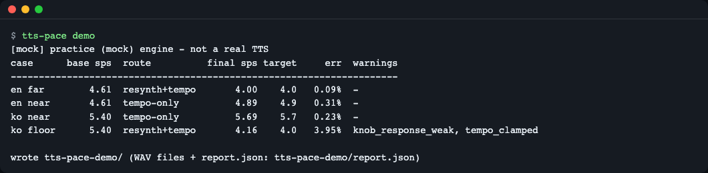
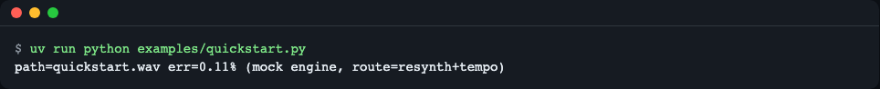
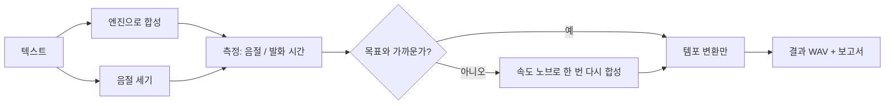
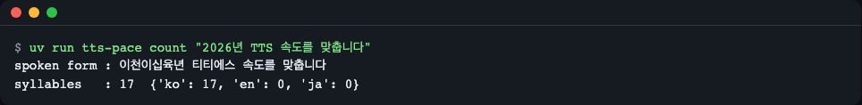
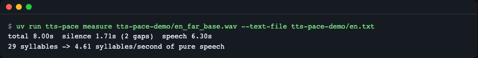
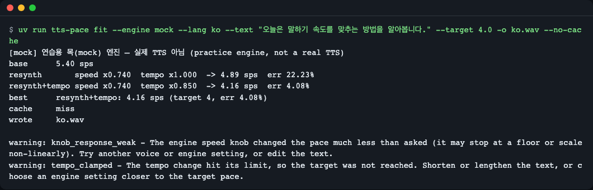

# tts-pace

**한국어** | [English](README.en.md)

> **English summary** — A small Python library and CLI that measures the speaking rate of speech audio (syllables per second of *pure speech*, silences excluded) and fits a TTS engine's output to a target pace: first with the engine's own speed knob, then with a bounded, pitch-preserving tempo change. You can also give a target total length in seconds (`--target-duration`) instead of a pace. One runtime dependency (numpy), no API key, and a practice (mock) engine so you can try everything offline. Install: `uv add git+https://github.com/LeeGyeongPil/tts-pace`.

TTS 음성이 "초당 몇 음절" 속도로 말하는지 재고, 목표 속도에 맞춰 주는 파이썬 라이브러리 겸 명령줄 도구입니다. 영상 더빙·내레이션·낭독처럼 "이 문장은 4초 안에 끝나야 한다" 같은 요구가 있을 때 씁니다.

비유하면 TTS의 속도 설정은 눈금 없는 수도꼭지입니다. 돌린 만큼 물이 나오는지 알 수 없습니다. tts-pace는 계량기를 달고, 눈금을 보면서 손으로 조금씩 다시 돌려 주는 도구입니다.



*`tts-pace demo` 실행 결과(연습용 목 엔진). 네 경우 중 셋은 오차 0.5% 이내이고, 마지막 줄은 한계에 걸려 경고가 나온 경우입니다.*

## 설치

```bash
# 라이브러리로 쓸 때 (프로젝트에 추가)
uv add git+https://github.com/LeeGyeongPil/tts-pace

# 저장소를 받아서 바로 실행해 볼 때
git clone https://github.com/LeeGyeongPil/tts-pace && cd tts-pace && uv sync
```

- 필요한 것: Python 3.12 이상, [uv](https://docs.astral.sh/uv/)(없으면 `curl -LsSf https://astral.sh/uv/install.sh | sh`). 최소 리눅스 컨테이너에서는 `git`과 `curl`만 더 있으면 됩니다.
- 런타임 의존성은 **numpy 하나**입니다. ffmpeg·`say`·Piper는 선택 사항입니다.
- 키(API key)는 필요 없습니다. 환경 변수는 전부 선택이며 [.env.example](.env.example)에 있습니다.

## 빠르게 시작하기

`examples/quickstart.py` 입니다. 복사해서 바로 돌아갑니다.

```python
from tts_pace import MockEngine, fit

result = fit(
    "Today we learn how to match the speaking rate of a synthetic voice.",
    target_sps=4.0,
    engine=MockEngine("en"),
    out="quickstart.wav",
)
print(f"path={result.best.path} err={result.best.err_pct:.2f}% (mock engine, route={result.route})")
```

```bash
uv run python examples/quickstart.py
```

```text
path=quickstart.wav err=0.11% (mock engine, route=resynth+tempo)
```



*`MockEngine`은 **연습용 목(mock) 엔진**입니다. 진짜 음성이 아니라 음절 수만큼 짧은 소리 덩어리와 쉼을 만들어 낼 뿐이지만, 측정·템포 변환 코드는 진짜와 똑같이 통과합니다. 실제 TTS는 `SayEngine`·`PiperEngine`·`CallableEngine`으로 바꿔 끼웁니다(아래 [API](#api)).*

## 핵심 개념

1. **말속도(sps)** — 음절 수를 *쉼을 뺀 발화 시간*으로 나눈 값(syllables per second). 글자 수나 전체 길이로 나누면 문장 사이 쉼 때문에 값이 흔들려서, 0.6초 이상 이어지는 무음은 시간에서 뺍니다.
2. **속도 노브(knob)** — TTS 엔진이 주는 "더 빠르게/느리게" 설정. 그런데 값을 1.2배로 줘도 실제 속도가 1.2배가 된다는 보장이 없습니다(비선형, 하한에서 멈춤). 그래서 **재서 확인**합니다.
3. **피치 보존 템포 변환** — 목소리 높이를 바꾸지 않고 재생 속도만 바꾸는 후처리. 많이 바꾸면 소리가 망가지므로 0.85~1.15배로 제한하고, 마지막 미세 보정에만 씁니다.
4. **폐루프 제어** — "합성 → 측정 → 비교 → 보정"을 닫힌 고리로 돌립니다. 에어컨이 온도를 재고 세기를 조절하는 것과 같은 방식입니다.



위 그림을 한 단계씩 풀면 다음과 같습니다.

- **음절 세기**: 숫자·약어를 읽는 소리로 바꾼 뒤(`2026` → `이천이십육`) 한글 블록, 영어 모음 묶음, 일본어 모라를 셉니다.
- **측정**: 쉼을 뺀 발화 시간으로 나누어 sps를 얻습니다.
- **판단**: 기본 합성의 오차가 10% 이내면 노브를 건드리지 않고 템포만 바꿉니다(`tempo-only`). 아니면 노브를 한 번 조정해 다시 합성하고(`resynth`) 남은 오차를 템포로 메웁니다(`resynth+tempo`).
- **결과**: 가장 목표에 가까운 후보를 고르고, 한계에 걸렸으면 경고와 권고 문구를 함께 돌려줍니다.

## 단계별 따라 하기

저장소를 받은 폴더에서 차례로 실행합니다(전부 키 없이, 목 엔진으로 0.2초 안팎).

### 1. 데모 한 번에 돌려 보기

```bash
uv run tts-pace demo
```

```text
[mock] 연습용 목(mock) 엔진 — 실제 TTS 아님 (practice engine, not a real TTS)
case      base sps  route          final sps target     err  warnings
---------------------------------------------------------------------
en far        4.61  resynth+tempo       4.00    4.0   0.09%  -
en near       4.61  tempo-only          4.89    4.9   0.31%  -
ko near       5.40  tempo-only          5.69    5.7   0.23%  -
ko floor      5.40  resynth+tempo       4.16    4.0   3.95%  knob_response_weak, tempo_clamped

wrote tts-pace-demo/ (WAV files + report.json: tts-pace-demo/report.json)
```

뜻: `base sps`는 처음 합성한 속도, `route`는 맞춘 방법, `err`는 목표와의 차이입니다. `en far`는 목표가 멀어서 노브까지 썼고, `en near`·`ko near`는 가까워서 템포만 썼습니다. `ko floor`는 이 가짜 한국어 엔진이 속도 하한에서 더 느려지지 않도록 만들어 둔 경우라서 오차가 3.95% 남고 경고가 붙습니다. 만들어진 WAV와 `report.json`은 `tts-pace-demo/`에 저장됩니다.

### 2. 음절 세기

```bash
uv run tts-pace count "2026년 TTS 속도를 맞춥니다"
```

```text
spoken form : 이천이십육년 티티에스 속도를 맞춥니다
syllables   : 17  {'ko': 17, 'en': 0, 'ja': 0}
```



*숫자와 약어가 읽는 소리로 바뀐 뒤 17음절로 세어집니다.*

뜻: TTS는 `2026`을 "이천이십육"으로 읽으므로, 글자 그대로 세면 속도가 틀어집니다. 읽는 소리로 바꾼 형태(`spoken form`)를 기준으로 셉니다.

### 3. 녹음 파일의 말속도 재기

```bash
uv run tts-pace measure tts-pace-demo/en_far_base.wav --text-file tts-pace-demo/en.txt
```

```text
total 8.00s  silence 1.71s (2 gaps)  speech 6.30s
29 syllables -> 4.61 syllables/second of pure speech
```



*전체 8.00초 중 쉼 1.71초를 빼고 6.30초 동안 29음절을 말했으므로 4.61 sps입니다.*

뜻: 전체 길이(8.00초)로 나누면 3.6 sps 정도로 느리게 나오지만, 문장 사이 쉼은 말속도가 아닙니다. 쉼을 뺀 값이 비교 기준입니다.

### 4. 목표에 맞추기 (경고가 나오는 경우)

```bash
uv run tts-pace fit --engine mock --lang ko \
  --text "오늘은 말하기 속도를 맞추는 방법을 알아봅니다." \
  --target 4.0 -o ko.wav --no-cache
```

```text
warning: knob_response_weak - The engine speed knob changed the pace much less than asked (it may stop at a floor or scale non-linearly). Try another voice or engine setting, or edit the text.
warning: tempo_clamped - The tempo change hit its limit, so the target was not reached. Shorten or lengthen the text, or choose an engine setting closer to the target pace.
[mock] 연습용 목(mock) 엔진 — 실제 TTS 아님 (practice engine, not a real TTS)
base      5.40 sps
resynth       speed x0.740  tempo x1.000  -> 4.89 sps  err 22.23%
resynth+tempo speed x0.740  tempo x0.850  -> 4.16 sps  err 4.08%
best      resynth+tempo: 4.16 sps (target 4, err 4.08%)
cache     miss
wrote     ko.wav
```



*5.40 sps에서 4.0 sps를 목표로 했을 때. 속도 노브를 0.74배로 낮춰도 4.89 sps까지만 내려가고, 템포를 한계(0.85배)까지 써도 4.16 sps에서 멈춥니다.*

뜻: 노브를 0.74배로 줬는데 속도는 그만큼 줄지 않았습니다(`knob_response_weak`). 템포 변환도 0.85배 하한에 걸렸습니다(`tempo_clamped`). 이럴 때 도구는 억지로 늘리지 않고, 목표에 가장 가까운 결과와 경고를 돌려줍니다. 권고대로 문장 길이나 목표를 조정해야 합니다.

속도 대신 "쉼까지 포함해 전체 몇 초"로 목표를 줄 수도 있습니다. `--target`과 `--target-duration`은 함께 쓸 수 없고, 둘 중 하나는 꼭 줘야 합니다(어기면 종료 코드 2).

```bash
uv run tts-pace fit --engine mock --text "Today we learn how to match the rate." \
  --target-duration 4 -o o.wav --no-cache
```

```text
warning: tempo_clamped - The tempo change hit its limit, so the target was not reached. Shorten or lengthen the text, or choose an engine setting closer to the target pace.
[mock] 연습용 목(mock) 엔진 — 실제 TTS 아님 (practice engine, not a real TTS)
base      4.60 sps
resynth       speed x0.714  tempo x1.000  -> 3.77 sps  err 14.60%
resynth+tempo speed x0.714  tempo x0.850  -> 3.22 sps  err 2.15%
best      resynth+tempo: 3.22 sps (target 3.2864, err 2.15%)
length    3.85s (target 4.00s, err 3.85%)
cache     miss
wrote     o.wav
```

뜻: 목표 4.00초에 3.85초로 멈췄습니다. 템포가 0.85배 하한에 걸려서(`tempo_clamped`) `length` 줄이 남은 차이를 알려 줍니다. `length` 줄은 `--target-duration`을 쓸 때만 나옵니다.

`best` 줄의 `target 3.2864`는 목표 길이 4초를 이 문장의 쉼 제외 말속도로 환산한 목표 sps입니다(그래서 다른 줄과 소수점 자릿수가 다릅니다).

스크립트에서 쓰려면 `--json`을 붙입니다(0.3.0부터). 표준출력에는 보고서 JSON 한 줄만 나오고, 경고와 `[mock]` 안내는 표준오류로 갑니다. `--report` 파일에 저장되는 내용과 같습니다.

```bash
uv run tts-pace fit --engine mock --text "Today we learn pace." \
  --target 4 -o o.wav --no-cache --json 2>/dev/null
```

```text
{"version": 1, "engine": "mock-en", "mock": true, "mock_note": "practice (mock) engine, not a real TTS", "target_sps": 4.0, ...
```

(출력 앞부분만 적었습니다. 뒤에는 `syllables`, `route`, `best`, `candidates`, `warnings`, `cache_hit` 등이 이어집니다.)

캐시 기본값은 CLI와 라이브러리가 다릅니다. CLI는 기본으로 `~/.cache/tts-pace`에 캐시하고, 라이브러리 `fit()`은 `cache_dir`를 주지 않으면(환경 변수 `TTS_PACE_CACHE_DIR`도 없으면) 캐시하지 않습니다.

같은 명령에서 `--no-cache` 대신 `--cache-dir "$HOME/.cache/tts-pace"`(기본 캐시 위치는 `~/.cache/tts-pace`, `TTS_PACE_CACHE_DIR`로 바꿈)를 쓰면 두 번째 실행부터 `cache     hit`이 나오고 합성을 건너뜁니다.

### 5. 이미 있는 녹음을 템포만으로 맞추기

```bash
uv run tts-pace retime tts-pace-demo/en_far_base.wav --text-file tts-pace-demo/en.txt --target 4.2 -o slower.wav
```

전체 길이로 맞추려면 `--target 4.2` 대신 `--target-duration 9`를 씁니다. 이 파일은 원래 약 8초라서 느리게(길게) 늘리는 방향입니다.

```bash
uv run tts-pace retime tts-pace-demo/en_far_base.wav --text-file tts-pace-demo/en.txt --target-duration 9 -o slower.wav
```

```text
base      4.61 sps
tempo-only    speed x1.000  tempo x0.889  -> 4.10 sps  err 0.01%
best      tempo-only: 4.10 sps (target 4.09641, err 0.01%)
length    8.97s (target 9.00s, err 0.30%)
cache     miss
wrote     slower.wav
```

엔진 없이 파일만 있을 때 쓰는 명령입니다. 목표가 너무 멀면(예: `--target 2.0`) 0.85배 하한에서 멈추고 `tempo_clamped` 경고를 냅니다. 이때도 종료 코드는 0이므로, 자동화에서는 경고 여부를 `--json` 출력(`retime --json`, `fit --json` 모두)의 `warnings` 필드나 보고서로 확인하세요.

## API

`tts_pace`가 내보내는 공개 이름입니다. 여기 없는 모듈 내부 함수는 쓰지 않습니다.

| 이름 | 하는 일 | 주요 인자 | 반환 |
|---|---|---|---|
| `count_syllables(text, lang="auto", normalize=None)` | 읽는 소리 기준 음절 수 | `lang`: `auto/ko/en/ja`(숫자·약어 읽기에만 영향), `normalize`: `{"2026": "twenty twenty six"}` | `SyllableCount` (`total`, `by_script`, `normalized_text`, `unsupported`) |
| `measure(audio, text=None, syllables=None, *, silence_db=-60.0, min_silence=0.6, backend="auto", limiter=None)` | 쉼을 뺀 발화 시간과 말속도 측정 | `audio`: WAV 경로 또는 `AudioClip`; `text`와 `syllables`는 동시에 줄 수 없음 | `Measurement` (`total_s`, `silence_s`, `net_s`, `gaps`, `sps`) |
| `retime(audio, factor, out=None, backend="auto", clamp=False, *, tempo_range=(0.85, 1.15), limiter=None)` | 피치를 유지한 채 속도 변경(1.1 = 10% 빠르게) | 범위 밖 `factor`는 `ValueError`, `clamp=True`면 경계값으로 자름 | `AudioClip` |
| `fit(text, target_sps, engine, out=None, *, target_duration=None, tolerance=0.10, tempo_range, cache_dir=None, lang="auto", normalize=None, limiter=None, keep_candidates=False, silence_db, min_silence, tempo_backend, measure_backend)` | 합성 → 측정 → 노브/템포 보정의 폐루프 | `engine`: `SpeedEngine`; `cache_dir`: 폴더, `True`(기본 위치), `False`(안 씀), `None`(기본값: 환경 변수 `TTS_PACE_CACHE_DIR`가 있을 때만 캐시); `target_duration`: 쉼 포함 전체 길이(초). `target_sps`와 둘 중 하나만 주고(길이 모드는 `target_sps=None`), 둘 다 주거나 둘 다 없거나 0 이하면 `ValueError`; `limiter`: 동시 실행 제한용 `Limiter`; `silence_db`·`min_silence`: 쉼 판정 기준(`measure`와 같음); `tempo_backend`·`measure_backend`: 템포 변환·디코딩에 쓸 방식(기본 `auto`) | `FitResult` (`best`, `base`, `candidates`, `route`, `warnings`, `advice`, `cache_hit`, `save_report()`) |
| `fit_audio(audio, text, target_sps, out=None, *, target_duration=None, tolerance=0.10, tempo_range, silence_db, min_silence, tempo_backend, measure_backend, limiter=None, lang="auto", normalize=None)` | 엔진 없이 기존 녹음을 템포만으로 맞춤 | 같음 | `FitResult` |
| `MockEngine(preset="en")` | 연습용 목 엔진(`"en"`/`"ko"`, `base_sps`, `elasticity`, `silent_floor`, `jitter`, `seed` 조정 가능) | | 엔진 |
| `CallableEngine(fn, *, speed_range=(0.5, 2.0), deterministic=False, cache_id=None, name="callable", has_speed_knob=True)` | 파이썬 함수 하나를 엔진으로 포장 | `fn(text, speed)`는 `AudioClip`, WAV 경로, `(samples, sample_rate)` 중 하나를 반환 | 엔진 |
| `SayEngine(voice=None, *, base_wpm=175, speed_range=(0.86, 1.6))` | macOS `say` 호출 | macOS 전용 | 엔진 |
| `PiperEngine(voice=None, *, speed_range=(0.6, 1.7), sentence_silence=0.8)` | Piper 호출(사용자가 설치한 `piper`를 별도 프로세스로 실행) | `voice`: `.onnx` 경로 또는 `TTS_PACE_PIPER_VOICE` | 엔진 |
| `Limiter(max_concurrent=2, max_waiting=8)` | 합성·템포·ffmpeg 동시 실행 수 제한 | 자리가 없고 대기열도 차면 `BusyError` | 컨텍스트 매니저 `slot()` |
| `AudioClip`, `Measurement`, `SyllableCount`, `Candidate`, `FitResult`, `EngineInfo`, `SpeedEngine` | 데이터 타입과 엔진 프로토콜 | | |
| 예외 | `TtsPaceError`(공통 부모), `EngineError`, `AudioFormatError`, `MeasurementError`, `UnsupportedTextError`, `BusyError`. 잘못된 인자는 `ValueError` | | |
| 경고 | `UnsupportedCharsWarning`(파이썬 `warnings` 모듈로 나오는 경고 클래스, 셀 수 없는 글자가 있을 때) | | |

`fit()`이 돌려주는 경고: `knob_response_weak`(노브가 기대만큼 안 듣는다), `knob_clamped`(요청 속도가 엔진 범위 밖이라 잘렸다), `tempo_clamped`(템포 한계에 걸렸다), `unsupported_chars`(셀 수 없는 글자가 있었다).

명령줄: `tts-pace {demo,count,measure,retime,fit}`. 각 명령의 옵션은 `uv run tts-pace <명령> --help`로 봅니다.

## 사용 예

### 1. 이미 있는 녹음의 속도 재고 맞추기

```python
from tts_pace import count_syllables, measure, fit_audio

text = "Today we learn how to match the speaking rate of a synthetic voice. It is a short lesson about pace and silence."
n = count_syllables(text)
print("syllables:", n.total, n.by_script)

m = measure("tts-pace-demo/en_far_base.wav", text=text)
print(f"total {m.total_s:.2f}s, silence {m.silence_s:.2f}s, speech {m.net_s:.2f}s -> {m.sps:.2f} sps")

r = fit_audio("tts-pace-demo/en_far_base.wav", text, target_sps=4.2, out="slower.wav")
print(r.route, f"{r.best.measurement.sps:.2f} sps", f"err {r.best.err_pct:.2f}%", r.warnings)
```

```text
syllables: 29 {'ko': 0, 'en': 29, 'ja': 0}
total 8.00s, silence 1.71s, speech 6.30s -> 4.61 sps
tempo-only 4.19 sps err 0.14% ()
```

(`tts-pace-demo/en_far_base.wav`는 `uv run tts-pace demo`가 만듭니다.)

### 2. 내가 쓰는 TTS를 연결하기

`CallableEngine`은 `fn(text, speed)` 함수 하나만 있으면 됩니다. 아래 `my_tts`는 설명용 가짜 소리를 만드는 자리표시자입니다. 실제로는 여기서 클라우드 API나 로컬 모델을 호출하고, `speed`(1.0 = 기본, 클수록 빠름)를 그 엔진의 단위로 바꿔 넘기면 됩니다.

```python
import numpy as np
from tts_pace import CallableEngine, fit

def my_tts(text: str, speed: float):
    # Stand-in for a real TTS call: one 0.1 s tone per character; faster speed -> shorter tones.
    sr = 16000
    tone = np.sin(2 * np.pi * 220 * np.arange(int(sr * 0.1 / speed)) / sr) * 0.5
    gap = np.zeros(int(sr * 0.02 / speed))
    return np.concatenate([np.concatenate([tone, gap]) for _ in text]).astype(np.float32), sr

engine = CallableEngine(my_tts, speed_range=(0.5, 2.0), name="my-tts")
r = fit("Hello there friend", target_sps=3.0, engine=engine, out="mine.wav")
print(r.route, f"{r.best.measurement.sps:.2f} sps", [round(c.speed, 2) for c in r.candidates])
```

```text
resynth 3.00 sps [1.0, 1.62]
```

뜻: 첫 합성(speed 1.0)을 재 보고, 속도 1.62로 한 번 다시 합성해서 3.00 sps에 맞췄습니다. 엔진이 같은 입력에 항상 같은 소리를 내면 `deterministic=True`와 `cache_id="내엔진:목소리"`를 주어 결과 캐시를 쓸 수 있습니다.

### 3. 실제 엔진 (macOS `say`, Piper)

```python
from tts_pace import SayEngine, fit
r = fit("오늘은 속도를 맞춥니다.", target_sps=4.5, engine=SayEngine("Yuna"), out="say.wav")
```

> 이 README를 쓴 시점에 `SayEngine`·`PiperEngine`을 **실제 음성으로 검증하지는 않았습니다.** 명령 구성과 오류 처리는 테스트했지만, 실제 엔진을 호출하는 테스트(`pytest -m real`)는 기본 실행에서 빠져 있습니다. 실제 엔진은 공유 자원이어서 느릴 수 있고, `say -r`은 약 150 wpm 아래에서 반응하지 않는 것이 관찰되어 기본 범위를 0.86~1.6배로 제한했습니다.

## 언제 쓰나

- **tts-pace가 맞는 때**: 더빙·내레이션처럼 목표 속도를 "쉼을 뺀 음절/초"로 맞춰야 할 때(목표 전체 길이는 `--target-duration`으로 줄 수 있습니다), 또는 이미 있는 녹음의 속도를 재고 템포(0.85~1.15배)만 조금 맞출 때. 설치는 numpy 하나면 됩니다.
- **다른 도구가 나은 때**: 고정 배율로 빠르게만 바꾸면 된다면 TTS 엔진 자체의 속도 옵션이나 [ffmpeg `atempo`](https://ffmpeg.org/ffmpeg-filters.html#atempo)로 충분합니다. 음성 합성 자체가 필요하면 [Piper](https://github.com/OHF-Voice/piper1-gpl) 같은 TTS 엔진을 쓰세요.
- tts-pace는 음성을 직접 합성하지 않는 측정·보정 계층입니다.

## 알게 된 것 (What we learned)

직접 재 본 값입니다. 측정일 2026-11-09, piper-tts 1.8.0(영어), macOS `say` 목소리 Yuna(한국어). 이 값이 기본 설정의 근거입니다.

| 항목 | 측정값 | 그래서 tts-pace는 |
|---|---|---|
| Piper `length_scale` 비례성 | 노이즈 0에서 0.7→6.49, 0.85→5.24, 1.0→4.88, 1.2→4.43, 1.5→3.59 sps. 1.0→1.2에서 기대(1/1.2배 = 4.07 sps)의 약 55%만 변함 | 노브 한 번으로 끝내지 않고 다시 재서 템포로 마저 맞춥니다. `MockEngine("en")`의 `elasticity=0.6`(속도^0.6)이 이 비선형을 흉내 냅니다 |
| `say -r` 하한 | Yuna는 `-r 120`과 `-r 150`이 같은 결과(7.531초, 4.91 sps). 175→220→280은 거의 비례(5.40→6.68→8.13 sps) | `SayEngine`의 기본 범위를 0.86~1.6배로 제한하고, 노브가 안 들으면 `knob_response_weak`를 냅니다. `MockEngine("ko")`의 `silent_floor=0.9`가 이 "조용한 하한"을 흉내 냅니다 |
| Piper 기본값의 비결정성 | 같은 문장을 두 번 합성하면 파일 해시와 길이(2.566초/2.601초)가 다름. `--noise-scale 0 --noise-w-scale 0`이면 같음 | `PiperEngine`이 노이즈를 0으로 고정해 캐시와 재현성을 지킵니다(기본 말속도도 약 4.6에서 4.88 sps로 바뀜) |
| 영어 음절 세기 정확도 | CMUdict 무작위 3,000단어에서 `syllables` 패키지 78.47%(사전 조사 단계 측정). 이 라이브러리 규칙은 같은 사전의 표본 1,994단어에서 89.6%(테스트 `tests/test_count_en_accuracy.py`) — 표본이 달라 엄밀한 비교는 아님 | 영어는 추정값임을 [한계](#한계)에 밝힙니다 |
| 쉼 검출 | Piper `--sentence-silence 0.8`의 문장 사이 쉼(약 0.85~0.99초)은 검출·제외됨. `say` 한국어는 쉼이 0.6초 미만이라 0개 | 쉼 기준을 0.6초로 둡니다 |

실제 엔진으로 맞춘 결과(목표 대비 오차): 영어 Piper 목표 4.0 sps는 재합성 + 템포로 0.17%, 한국어 `say` 목표 5.0 sps는 템포만으로 0.16%, 한국어 `say` 목표 4.0 sps는 템포가 0.85배 하한에 걸려 4.5% 였습니다. 이 수치는 설계 전 조사 단계에서 실제 Piper·`say`를 직접 돌려 얻은 것입니다. 완성된 `SayEngine`·`PiperEngine` 어댑터로 다시 검증한 것은 아니며, [사용 예 3](#3-실제-엔진-macos-say-piper)에 적은 대로 기본 테스트에도 넣지 않았습니다.

## 한계

- 영어 음절은 규칙 기반 추정입니다(CMUdict 단어 1994개 표본에서 단어 단위 일치율 89.6%). 한국어는 글자 블록, 일본어는 모라 단위로 셉니다.
- 템포 변환은 0.85~1.15배로 제한됩니다. 그 밖의 차이는 노브나 문장 길이로 풀어야 합니다.
- `--target-duration`의 길이는 쉼을 포함한 전체 길이이고, 필요한 템포가 0.85~1.15배 안일 때만 정확히 맞습니다. 그 밖이면 경고와 함께 가까운 곳에서 멈춥니다.
- 알려진 한계(0.3.0 기준): `--target-duration`에 0 이하 값을 주면 `error:` 줄 뒤에 목 엔진 안내 줄이 함께 찍힙니다(종료 코드는 2로 정상). 길이 모드의 일부 테스트는 값 단위 검증이 약해 이후 보강할 예정입니다. `--json` 테스트에는 `--lang`, `--target-duration`+`--cache-dir` 조합이 아직 없습니다. `--json`에서 오류가 나면(목 모드) 표준오류 첫 줄은 `[mock]` 안내이고 `error:` 줄은 그다음에 옵니다(표준출력은 비어 있고 종료 코드는 2).
- 목 엔진은 측정·보정 로직을 연습하기 위한 것이며 실제 음성의 품질과 속도 특성을 대표하지 않습니다.

## 버전·호환성

- 유의적 버전(SemVer)을 따릅니다. 0.x 동안은 마이너 버전에서 API가 바뀔 수 있고, 바뀌면 [CHANGELOG.md](CHANGELOG.md)에 적습니다.
- Python 3.12 이상.

## 문제 해결

| 증상 | 원인 | 해결 |
|---|---|---|
| `knob_response_weak` 경고 | 엔진의 속도 노브가 하한·상한에서 멈추거나 비선형 | 다른 목소리·엔진 설정을 쓰거나 문장을 고칩니다 |
| `tempo_clamped` 경고 | 목표(속도 또는 `--target-duration` 길이)까지 필요한 템포가 0.85~1.15배 밖 | 문장 길이나 목표 속도·길이를 조정합니다 |
| `No countable syllables found` 오류 | 기호만 있거나 지원하지 않는 문자만 있어 셀 글자가 없음 | `normalize={"2026": "twenty twenty six"}`로 읽는 소리를 알려 줍니다 |
| `SayEngine only works on macOS` | `say`는 macOS 전용 | `CallableEngine`이나 `PiperEngine`을 씁니다 |
| `PiperEngine needs a voice .onnx file` | 음성 파일을 지정하지 않음 | `voice=...` 또는 `TTS_PACE_PIPER_VOICE`를 설정합니다 |

## 개발·기여

```bash
uv sync
uv run pytest -q   # 99 passed, 2 deselected (실제 엔진이 필요한 테스트는 기본에서 제외)
```

## 더 알아보기

- Piper TTS: https://github.com/OHF-Voice/piper1-gpl (확인 2026-11-09)
- Piper 말속도 조절 사례 토론: https://community.home-assistant.io/t/how-to-set-piper-speaking-rate/662014 (확인 2026-11-09)

## 라이선스

MIT. Piper는 GPL 라이선스이므로 이 패키지에 포함하지 않고, 사용자가 설치한 `piper`를 별도 프로세스로 호출합니다.

`tests/fixtures/cmudict_sample.tsv`는 CMU Pronouncing Dictionary 표본입니다(BSD 2조항, `tests/fixtures/CMUDICT-LICENSE`).
